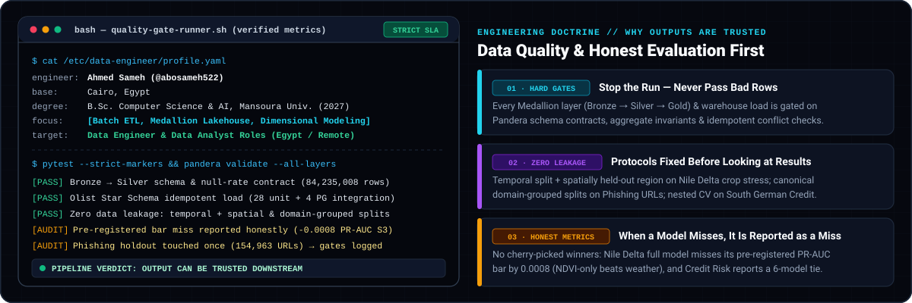
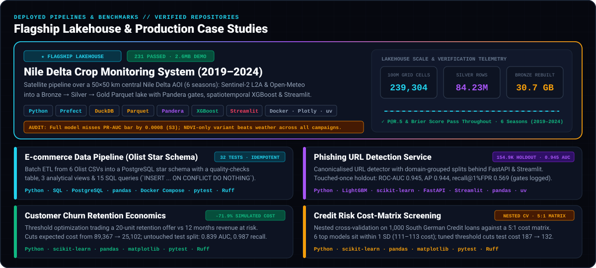
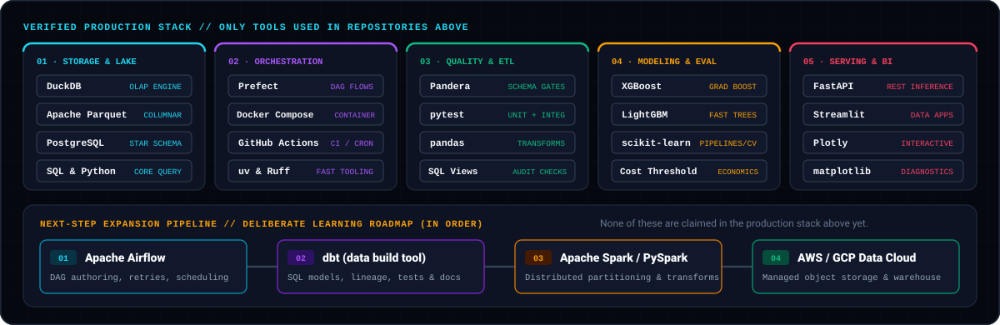
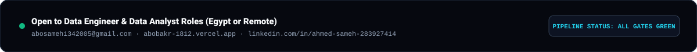

<!-- ===================================================================== -->
<!-- AHMED SAMEH (@abosameh522) — DATA ENGINEERING CONTROL PLANE README   -->
<!-- ===================================================================== -->

<div align="center">

<!-- 01 · ANIMATED HERO CONTROL PLANE & LIVE MEDALLION DAG -->
<picture>
  <source media="(prefers-color-scheme: dark)" srcset="assets/banner-dark.svg">
  <source media="(prefers-color-scheme: light)" srcset="assets/banner-light.svg">
  
</picture>

<br/>

<!-- QUICK ACTION BAR -->
[](https://abobakr-1812.vercel.app)&nbsp;&nbsp;
[](https://abobakr-1812.vercel.app)&nbsp;&nbsp;
[](https://www.linkedin.com/in/ahmed-sameh-283927414)&nbsp;&nbsp;
[](mailto:abosameh1342005@gmail.com)&nbsp;&nbsp;
[](https://github.com/abosameh522)

<!-- ANIMATED PIPELINE DIVIDER -->
<picture>
  <source media="(prefers-color-scheme: dark)" srcset="assets/divider-dark.svg">
  <source media="(prefers-color-scheme: light)" srcset="assets/divider-light.svg">
  
</picture>

<!-- 02 · LIVE QUALITY-GATE TERMINAL & ENGINEERING DOCTRINE -->
<picture>
  <source media="(prefers-color-scheme: dark)" srcset="assets/telemetry-dark.svg">
  <source media="(prefers-color-scheme: light)" srcset="assets/telemetry-light.svg">
  
</picture>

<!-- ANIMATED PIPELINE DIVIDER -->
<picture>
  <source media="(prefers-color-scheme: dark)" srcset="assets/divider-dark.svg">
  <source media="(prefers-color-scheme: light)" srcset="assets/divider-light.svg">
  
</picture>

<!-- 03 · DEPLOYED PIPELINES & PRODUCTION CASE STUDIES -->
<picture>
  <source media="(prefers-color-scheme: dark)" srcset="assets/projects-dark.svg">
  <source media="(prefers-color-scheme: light)" srcset="assets/projects-light.svg">
  
</picture>

</div>

<!-- CLICKABLE REPOSITORY LAUNCHPAD & ARCHITECTURE DEEP-DIVE -->
<table width="100%">
  <thead>
    <tr>
      <th align="left" width="26%">Pipeline / Repository</th>
      <th align="left" width="49%">Architecture, Quality Gates &amp; Verified Outcomes</th>
      <th align="left" width="25%">Production Stack</th>
    </tr>
  </thead>
  <tbody>
    <tr>
      <td>
        <b>01 · Flagship Lakehouse</b><br/>
        <a href="https://github.com/abosameh522/delta-crop-monitoring-system"><b>Nile Delta Crop Monitoring System</b></a><br/>
        <sub><code>231 passed</code> · <code>30.7 GB Bronze</code></sub>
      </td>
      <td>
        Satellite batch pipeline over a <b>50 × 50 km AOI</b> (6 seasons, 2019–2024): Sentinel-2 L2A &amp; Open-Meteo ingested into a <b>Bronze → Silver → Gold Parquet lake</b> (<b>239,304</b> grid cells, <b>84,235,008</b> quality-checked Silver rows). Headline <code>full</code> XGBoost model misses its pre-registered PR-AUC bar by <code>0.0008</code> (S3), <code>0.0014</code> (S4) and <code>0.0140</code> (S5) — reported as a miss while NDVI-only beats weather and P@R.5 / Brier pass throughout. Includes a committed <b>2.6 MB demo sample</b> for the Streamlit dashboard.
      </td>
      <td>
        <code>Python</code> <code>Prefect</code> <code>DuckDB</code> <code>Parquet</code> <code>Pandera</code> <code>XGBoost</code> <code>Streamlit</code> <code>Plotly</code> <code>Docker</code> <code>uv</code>
      </td>
    </tr>
    <tr>
      <td>
        <b>02 · Dimensional Warehouse</b><br/>
        <a href="https://github.com/abosameh522/ecommerce-data-pipeline"><b>E-commerce Data Pipeline</b></a><br/>
        <sub><code>28 unit + 4 PG tests</code> · <code>Star Schema</code></sub>
      </td>
      <td>
        Batch ETL from six Olist CSVs into a <b>PostgreSQL star schema</b> with a dedicated <code>quality_checks</code> audit table, three analytical views and 15 SQL analytical queries. Loads are strictly idempotent (<code>INSERT … ON CONFLICT DO NOTHING</code>) and verified by 32 automated tests.
      </td>
      <td>
        <code>Python</code> <code>SQL</code> <code>PostgreSQL</code> <code>pandas</code> <code>Docker Compose</code> <code>pytest</code> <code>Ruff</code>
      </td>
    </tr>
    <tr>
      <td>
        <b>03 · Real-Time Inference &amp; Splits</b><br/>
        <a href="https://github.com/abosameh522/phishing-url-detection"><b>Phishing URL Detection</b></a><br/>
        <sub><code>154,963 holdout URLs</code> · <code>FastAPI</code></sub>
      </td>
      <td>
        URL-only detector with canonicalised inputs and leakage-resistant <b>domain-grouped splits</b>, served through a unified predictor behind <b>FastAPI</b> and <b>Streamlit</b>. On the 154,963-URL holdout touched once: <code>ROC-AUC 0.945</code>, <code>AP 0.944</code>, <code>recall@1%FPR 0.569</code> — with strict threshold gates honestly logged as <b>FAILED</b>.
      </td>
      <td>
        <code>Python</code> <code>LightGBM</code> <code>scikit-learn</code> <code>FastAPI</code> <code>Streamlit</code> <code>pandas</code> <code>uv</code>
      </td>
    </tr>
    <tr>
      <td>
        <b>04 · Decision Economics</b><br/>
        <a href="https://github.com/abosameh522/customer-churn-prediction"><b>Customer Churn Prediction</b></a><br/>
        <sub><code>-71.9% Expected Cost</code> · <code>0.839 AUC</code></sub>
      </td>
      <td>
        Retention economics on IBM Telco: probability threshold trades a 20-unit retention offer against 12 months of revenue at risk. Random Forest won on simulated cost, cutting expected cost from <b>89,367 to 25,102</b>; untouched 20% test split scores <code>0.839 ROC-AUC</code> with <code>0.987 recall</code> at <code>0.08</code>.
      </td>
      <td>
        <code>Python</code> <code>scikit-learn</code> <code>pandas</code> <code>matplotlib</code> <code>pytest</code> <code>Ruff</code>
      </td>
    </tr>
    <tr>
      <td>
        <b>05 · Nested CV &amp; Cost Matrix</b><br/>
        <a href="https://github.com/abosameh522/credit-risk-analysis"><b>Credit Risk Analysis</b></a><br/>
        <sub><code>1,000 Loans</code> · <code>5:1 Cost Matrix</code></sub>
      </td>
      <td>
        Nested cross-validation on 1,000 South German Credit loans against a <b>5:1 asymmetric cost matrix</b>. No false winner is claimed — the six strongest models sit between <b>111 and 113 cost units</b> (inside 1 SD) — and on the 200-row test set the tuned threshold cuts cost from <b>187 to 132</b>.
      </td>
      <td>
        <code>Python</code> <code>scikit-learn</code> <code>pandas</code> <code>matplotlib</code> <code>pytest</code> <code>Ruff</code>
      </td>
    </tr>
  </tbody>
</table>

<div align="center">

<!-- ANIMATED PIPELINE DIVIDER -->
<picture>
  <source media="(prefers-color-scheme: dark)" srcset="assets/divider-dark.svg">
  <source media="(prefers-color-scheme: light)" srcset="assets/divider-light.svg">
  
</picture>

<!-- 04 · VERIFIED TECH STACK MATRIX & NEXT-STEP ROADMAP -->
<picture>
  <source media="(prefers-color-scheme: dark)" srcset="assets/stack-dark.svg">
  <source media="(prefers-color-scheme: light)" srcset="assets/stack-light.svg">
  
</picture>

<!-- ANIMATED PIPELINE DIVIDER -->
<picture>
  <source media="(prefers-color-scheme: dark)" srcset="assets/divider-dark.svg">
  <source media="(prefers-color-scheme: light)" srcset="assets/divider-light.svg">
  
</picture>

<!-- 05 · GITHUB TELEMETRY & ISOMETRIC COMMIT CALENDAR (SIDE-BY-SIDE DASHBOARD) -->
<table width="100%">
  <thead>
    <tr>
      <th width="50%" align="center"><code>GITHUB TELEMETRY // ACTIVITY &amp; LANGUAGES</code></th>
      <th width="50%" align="center"><code>COMMIT TOPOLOGY // 365-DAY ISOMETRIC LAKE</code></th>
    </tr>
  </thead>
  <tbody>
    <tr>
      <td width="50%" align="center" valign="middle">
        
      </td>
      <td width="50%" align="center" valign="middle">
        
      </td>
    </tr>
  </tbody>
</table>

<!-- 06 · INTERACTIVE DEEP-DIVE ACCORDION (ENGINEERING SPECIFICATIONS) -->
<details>
  <summary><b>⚡ Click to Inspect: Full Pipeline Specifications, Evaluation Protocols &amp; Reproducibility Commands</b></summary>
  <br/>
  <div align="left">

  ### 1. Reproducing the Flagship Nile Delta Lakehouse (`delta-crop-monitoring-system`)
  ```bash
  git clone https://github.com/abosameh522/delta-crop-monitoring-system.git
  cd delta-crop-monitoring-system
  uv sync --frozen
  uv run pytest                  # 231 passed, 9 skipped, 2 deselected on a fresh clone
  uv run streamlit run app.py    # Runs immediately on the committed 2.6 MB demo sample (no 31 GB lake required)
  ```

  ### 2. Why Pre-Registered Evaluation Protocols Matter
  | System | Split &amp; Holdout Protocol | Quality / Decision Gate | Verified Outcome |
  | :--- | :--- | :--- | :--- |
  | **Nile Delta Crop Stress** | Temporal campaign split + spatially held-out region (239,304 grid cells) | Pandera schema &amp; null-rate gates between Bronze, Silver (84.23M rows) &amp; Gold | `full` model misses PR-AUC bar by `0.0008` (S3); NDVI-only beats weather in all 3 campaigns; P@R.5 &amp; Brier pass |
  | **Olist E-Commerce ETL** | 6 source CSVs → normalized PostgreSQL Star Schema | Idempotent conflict loading (`ON CONFLICT DO NOTHING`) + `quality_checks` table | 28 unit tests + 4 live PostgreSQL integration tests + 3 views + 15 SQL queries |
  | **Phishing URL Detector** | Canonicalised URLs + leakage-resistant domain-grouped holdout (154,963 URLs) | Single-touch holdout evaluation served behind FastAPI &amp; Streamlit | `ROC-AUC 0.945`, `AP 0.944`, `recall@1%FPR 0.569` (gate miss reported transparently) |
  | **Customer Churn Economics** | 80/20 stratified holdout with cost-matrix threshold optimization | 20-unit retention offer vs. 12 months revenue at risk | Expected cost reduced from **89,367 → 25,102** (`0.839 ROC-AUC`, `0.987 recall @ 0.08`) |
  | **South German Credit Risk** | Nested cross-validation (1,000 loans) + 200-row test set | 5:1 asymmetric default cost matrix | Top 6 models within 1 SD (`111–113` cost units); tuned threshold cuts test cost **187 → 132** |

  </div>
</details>

<br/>

<!-- 07 · ANIMATED STATUS FOOTER -->
<picture>
  <source media="(prefers-color-scheme: dark)" srcset="assets/footer-dark.svg">
  <source media="(prefers-color-scheme: light)" srcset="assets/footer-light.svg">
  
</picture>

</div>
