<!-- ANIMATED HERO DATA PIPELINE BANNER -->
<picture>
  <source media="(prefers-color-scheme: dark)" srcset="assets/banner-dark.svg">
  <source media="(prefers-color-scheme: light)" srcset="assets/banner-light.svg">
  
</picture>

 

---

## 👋 About Me

I'm **Ahmed Sameh**, a **Junior Data Engineer** based in **Cairo, Egypt**.  
I build clean, reliable **ETL/ELT pipelines**, design structured **data warehouses & lakehouses**, and enforce **data quality checks** so downstream analytics can be trusted.

- 🧱 Focused on **SQL**, **Python**, **Data Modeling (Star/Snowflake)**, and **Medallion Architecture** (`Bronze → Silver → Gold`).
- 🛡️ Care about **idempotency**, **incremental loads**, **schema validation**, and clean handling of pipeline failures.
- 🐧 Comfortable working daily on **Linux**, **Bash**, **Git**, and **Docker**.

<picture>
  <source media="(prefers-color-scheme: dark)" srcset="assets/medallion-dark.svg">
  <source media="(prefers-color-scheme: light)" srcset="assets/medallion-light.svg">
  
</picture>

---

## 🛠️ Skills

| # | Area | Tools & Core Concepts |
| :-: | :--- | :--- |
| **1** | **SQL & Relational Databases** |    JOINs · CTEs · Window Functions (`ROW_NUMBER`, `RANK`, `LAG`/`LEAD`) · Indexing · Deduplication · `MERGE` / Upserts |
| **2** | **Python for Data** |    Data Structures · Pandas (`groupby`, `merge`, `pivot`) · CSV / JSON / Parquet · Automation & Error Handling |
| **3** | **ETL / ELT & Orchestration** |    Batch ETL & ELT Patterns · Incremental vs. Full Loads · Idempotency · Failure Handling & Scheduling |
| **4** | **Data Modeling & Warehousing** |   Fact & Dimension Tables · Normalization vs. Denormalization · Slowly Changing Dimensions (SCD Type 1, 2, 3) |
| **5** | **Data Quality & Testing** |    Schema Validation · Freshness, Completeness & Accuracy Checks · Row-Count Audits · Pipeline Logging |
| **6** | **Big Data Foundations** |   Spark SQL & DataFrames · Hadoop Ecosystem Fundamentals · Choosing Spark vs. Pandas |
| **7** | **Cloud Data Platforms** |    AWS (`S3`, `Glue`, `Redshift`, `Athena`, `Lambda`) · GCP (`GCS`, `BigQuery`, `Dataflow`, `Composer`) · Azure (`Blob`, `Data Factory`, `Synapse`, `Databricks`) |
| **8** | **Linux, Shell & Containers** |    Shell Scripting (`grep`, `awk`, `sed`, `find`) · Remote Servers (`SSH`, `SCP`) · Docker & Docker Compose |
| **9** | **Version Control & Collaboration** |    Branching, Merging, Rebasing & Pull Requests · Clean Commit History · CI Workflows |

---

## 🚀 Featured Projects

| Project | Highlights | Stack |
| :--- | :--- | :--- |
| 🛰️ [**Nile Delta Crop Lakehouse**](https://github.com/abosameh522/delta-crop-monitoring-system) | End-to-end batch pipeline ingesting Sentinel-2 & weather data into a **Bronze → Silver → Gold Parquet lakehouse** (84.2M Silver rows, Pandera quality gates, 231 tests). | `Python` `Prefect` `DuckDB` `Parquet` `Pandera` `Docker` |
| 🛒 [**E-Commerce Data Pipeline**](https://github.com/abosameh522/ecommerce-data-pipeline) | Batch ETL loading 6 Olist CSVs into a **PostgreSQL Star Schema** with idempotent loads (`ON CONFLICT DO NOTHING`), `quality_checks` audit table, views, and 32 tests. | `Python` `SQL` `PostgreSQL` `Pandas` `Docker` `pytest` |
| 🔐 [**Phishing URL Detection**](https://github.com/abosameh522/phishing-url-detection) | Leakage-resistant data & inference pipeline with canonicalized URL features and domain-grouped splits, served via FastAPI & Streamlit. | `Python` `LightGBM` `FastAPI` `Streamlit` |

---

## 📊 GitHub Activity

  <table width="100%">
    <tr>
      <td width="50%" align="center" valign="middle">
        
      </td>
      <td width="50%" align="center" valign="middle">
        
      </td>
    </tr>
  </table>

 

<!-- ANIMATED DATA WAVE FOOTER -->
<picture>
  <source media="(prefers-color-scheme: dark)" srcset="assets/footer-dark.svg">
  <source media="(prefers-color-scheme: light)" srcset="assets/footer-light.svg">
  
</picture>

