<picture>
  <source media="(prefers-color-scheme: dark)" srcset="assets/banner-dark.svg">
  <source media="(prefers-color-scheme: light)" srcset="assets/banner-light.svg">
  
</picture>

## About me

I'm a **Computer Science and AI student at Mansoura University**, building toward a **data engineering career**. I like the parts that make data trustworthy: contracts, schemas, quality checks, idempotent loads, and evaluation protocols that include the misses. I'm looking for data engineering opportunities in **Egypt and with remote teams**.

This profile is my field notebook: small batch systems, honest results, and notes on what I would do next.

## The pipeline, as a visual metaphor

*Each repository runs its own batch pipeline. This is a visual language, not one shared live DAG.*

## Skills I actually use

<picture>
  <source media="(prefers-color-scheme: dark)" srcset="assets/skills-dark.svg">
  <source media="(prefers-color-scheme: light)" srcset="assets/skills-light.svg">
  
</picture>

**Working with:** Python, SQL, Parquet, DuckDB, PostgreSQL, Pandera, Prefect, pytest, scikit-learn, XGBoost, LightGBM, pandas, Matplotlib, Streamlit, FastAPI, Docker Compose.

## Featured projects

<table width="100%">
  <tr>
    <td colspan="2" valign="top">
      <b>01 · Flagship — <a href="https://github.com/abosameh522/delta-crop-monitoring-system">Nile Delta Crop Monitoring</a></b> 
      Sentinel-2 + Open-Meteo → Bronze/Silver/Gold Parquet with quality gates and a runnable Streamlit demo; the full model misses its pre-registered PR-AUC bar in all three campaigns. 
      <code>Python</code> · <code>Prefect</code> · <code>DuckDB</code> · <code>Parquet</code> · <code>Pandera</code> · <code>XGBoost</code> · <code>Streamlit</code> · <code>Docker</code>
    </td>
  </tr>
  <tr>
    <td width="50%" valign="top">
      <b><a href="https://github.com/abosameh522/ecommerce-data-pipeline">E-commerce Data Pipeline</a></b> 
      Six Olist CSVs → a validated PostgreSQL star schema with a quality-check audit table; the loader is a full insert-only batch, not incremental. 
      <code>Python</code> · <code>SQL</code> · <code>PostgreSQL</code> · <code>pandas</code> · <code>Docker Compose</code>
    </td>
    <td width="50%" valign="top">
      <b><a href="https://github.com/abosameh522/phishing-url-detection">Phishing URL Detection</a></b> 
      Domain-grouped URL classification served through FastAPI and Streamlit; the overall gates are not all passing and the full corpus is not bundled. 
      <code>Python</code> · <code>LightGBM</code> · <code>scikit-learn</code> · <code>FastAPI</code> · <code>Streamlit</code>
    </td>
  </tr>
  <tr>
    <td width="50%" valign="top">
      <b><a href="https://github.com/abosameh522/customer-churn-prediction">Customer Churn Prediction</a></b> 
      Telco churn analysis with a simulated retention-cost threshold; the reported 71.9% cost reduction is a simulation output, not measured revenue saved. 
      <code>Python</code> · <code>pandas</code> · <code>scikit-learn</code> · <code>Matplotlib</code> · <code>pytest</code>
    </td>
    <td width="50%" valign="top">
      <b><a href="https://github.com/abosameh522/credit-risk-analysis">Credit Risk Analysis</a></b> 
      South German Credit nested-CV cost study; the 200-row holdout has already participated in model selection, so it is not independent. 
      <code>Python</code> · <code>scikit-learn</code> · <code>pandas</code> · <code>Matplotlib</code> · <code>Jupyter</code>
    </td>
  </tr>
</table>

## Contribution activity

<picture>
  <source media="(prefers-color-scheme: dark)" srcset="https://raw.githubusercontent.com/abosameh522/abosameh522/output/github-contribution-grid-snake-dark.svg">
  <source media="(prefers-color-scheme: light)" srcset="https://raw.githubusercontent.com/abosameh522/abosameh522/output/github-contribution-grid-snake.svg">
  
</picture>

Updated daily by GitHub Actions from the public contribution graph.

## Currently learning

These are goals, not skills claimed elsewhere on this page.

- dbt and dimensional modeling patterns beyond hand-written SQL
- Airflow-style orchestration and scheduling reliability
- Cloud object storage and warehouse services (S3/GCS, BigQuery/Snowflake)
- Streaming fundamentals, for cases where batch is the wrong tool

<b>⚡ Click to inspect: reproduction commands and project caveats</b>

 

These are the repositories' current documented paths. Full rebuilds need the external data and services each project notes.

| Project | Shortest path | Honest caveat |
| --- | --- | --- |
| Delta | `uv pip install -e ".[dev,dashboard]"` → `scripts/run_demo.sh` | Full lake and model artifacts are gitignored; the scheduled Prefect flow has not been observed end-to-end on the real lake. |
| E-commerce | `python src/pipeline.py` | Olist CSVs are not checked in; the 4 PostgreSQL integration tests need `TEST_DATABASE_URL`. |
| Phishing | `uv run uvicorn phishing_url_detection.api:app` | Inference uses the checked-in bundle; processed parquet and source snapshots are absent, and the gates are not all passing. |
| Churn | `python -m src.retention_cv` | Costs are stated assumptions; the 71.9% reduction is simulated, not measured revenue. |
| Credit Risk | `python src/nested_cv.py` | The 200-row holdout has already taken part in model selection; not independent until the split is fixed and rerun. |

## Let's talk

**Open to data engineering and analyst roles** — Egypt and remote teams.

[Email](mailto:abosameh1342005@gmail.com) · [Portfolio](https://abobakr-1812.vercel.app) · [LinkedIn](https://www.linkedin.com/in/ahmed-sameh-283927414)

