<picture>
  <source media="(prefers-color-scheme: dark)" srcset="assets/banner-dark.svg">
  <source media="(prefers-color-scheme: light)" srcset="assets/banner-light.svg">
  
</picture>

&nbsp;
&nbsp;
&nbsp;
&nbsp;

## About

I'm a Computer Science & AI student at Mansoura University (expected 2027) building batch data pipelines end to end: raw CSVs or satellite scenes in, a partitioned Parquet lake or a PostgreSQL star schema in the middle, and a Streamlit dashboard, FastAPI service or analytical view at the end.

What I care about most is whether the output can be trusted. Layers are gated on schema and aggregate checks that stop the run instead of passing bad rows downstream. Evaluation protocols are fixed before I look at results — a time split plus a spatially held-out region on the crop model, domain-grouped splits on the phishing classifier, nested cross-validation on the credit model. And when a model misses, it is reported as a miss: the Nile Delta stress model falls short of its pre-registered PR-AUC bar in all three campaigns (by 0.0008 in the closest), and adding weather does not beat NDVI history.

|  |  |
| :--- | :--- |
| **Focus** | Batch pipelines · dimensional modelling · data quality |
| **Based in** | El-Mahalla El-Kubra, Egypt |
| **Education** | B.Sc. Computer Science & AI, Mansoura University — expected 2027 |
| **Open to** | Data Engineer and Data Analyst roles, in Egypt or remote |

## Projects

### [Nile Delta Crop Monitoring System](https://github.com/abosameh522/delta-crop-monitoring-system)

A satellite pipeline over a 50 × 50 km AOI in the central Nile Delta, six seasons from 2019 to 2024: Sentinel-2 L2A and Open-Meteo ingested into a Bronze → Silver → Gold Parquet lake, quality gates between every layer, an XGBoost crop-stress model evaluated by time and by space, and a read-only Streamlit dashboard on top.

- **Scale** — 239,304 cells on a 100 m grid, 84,235,008 quality-checked Silver rows, and 30.7 GB of Bronze rebuilt from source.
- **Result** — the headline `full` model misses its pre-registered PR-AUC bar in all three campaigns, by 0.0008 (S3), 0.0014 (S4) and 0.0140 (S5). The NDVI-only variant beats it in every campaign, so the weather features add no measurable skill; P@R.5 and Brier pass throughout.
- **Reproducible** — 231 passed, 9 skipped, 2 deselected on a fresh clone, and a committed 2.6 MB demo sample runs the dashboard without the 31 GB lake.

`Python` · `Prefect` · `DuckDB` · `Parquet` · `Pandera` · `XGBoost` · `Streamlit` · `Plotly` · `Docker` · `uv`

### More projects

| Project | What it is | Stack |
| :--- | :--- | :--- |
| **[E-commerce Data Pipeline](https://github.com/abosameh522/ecommerce-data-pipeline)** | Batch ETL from six Olist CSVs into a PostgreSQL star schema with a quality-checks table, three analytical views and 15 SQL queries. Loads are idempotent (`INSERT … ON CONFLICT DO NOTHING`), checked by 28 unit tests plus 4 PostgreSQL integration tests. | Python, SQL, PostgreSQL, pandas, Docker Compose, pytest, Ruff |
| **[Phishing URL Detection](https://github.com/abosameh522/phishing-url-detection)** | URL-only detector with canonicalised inputs and domain-grouped splits, served through one predictor behind FastAPI and Streamlit. On the 154,963-URL holdout touched once: recall@1%FPR 0.569, ROC-AUC 0.945, AP 0.944 — with its gates reported as **FAILED**. | Python, scikit-learn, LightGBM, pandas, FastAPI, Streamlit, uv |
| **[Customer Churn Prediction](https://github.com/abosameh522/customer-churn-prediction)** | Retention economics on IBM Telco: the threshold trades a 20-unit offer against 12 months of revenue at risk. Random Forest won on simulated cost, with the tuned threshold cutting expected cost from 89,367 to 25,102; the untouched 20% test split scores 0.839 ROC-AUC with 0.987 recall at 0.08. | Python, scikit-learn, pandas, matplotlib, pytest, Ruff |
| **[Credit Risk Analysis](https://github.com/abosameh522/credit-risk-analysis)** | Nested cross-validation on 1,000 South German Credit loans against a 5:1 cost matrix. No winner is claimed — the six strongest models sit between 111 and 113 cost units, inside one standard deviation — and on the 200-row test set the tuned threshold cut cost from 187 to 132. | Python, scikit-learn, pandas, matplotlib, pytest, Ruff |

## Stack

Only what the repositories above actually use.

| Layer | Tools |
| :--- | :--- |
| **Languages & query** | Python, SQL |
| **Orchestration & CI** | Prefect, GitHub Actions |
| **Storage & lakehouse** | Parquet, DuckDB |
| **Warehouse** | PostgreSQL |
| **Transformation** | pandas |
| **Data quality & tests** | Pandera, pytest |
| **Modeling** | scikit-learn, XGBoost, LightGBM |
| **Serving** | FastAPI, Streamlit |
| **Visualization** | matplotlib, Plotly |
| **Platform & tooling** | Docker, Docker Compose, uv, Ruff |

## Metrics

   
  

## Currently learning

A deliberate next-step roadmap, in order. None of it is in the stack above yet.

| 01 | 02 | 03 | 04 |
| :--- | :--- | :--- | :--- |
| **Apache Airflow** DAG authoring, retries, scheduling | **dbt** SQL models, tests and docs | **PySpark** distributed transforms | **AWS or GCP** managed storage and warehouse |
